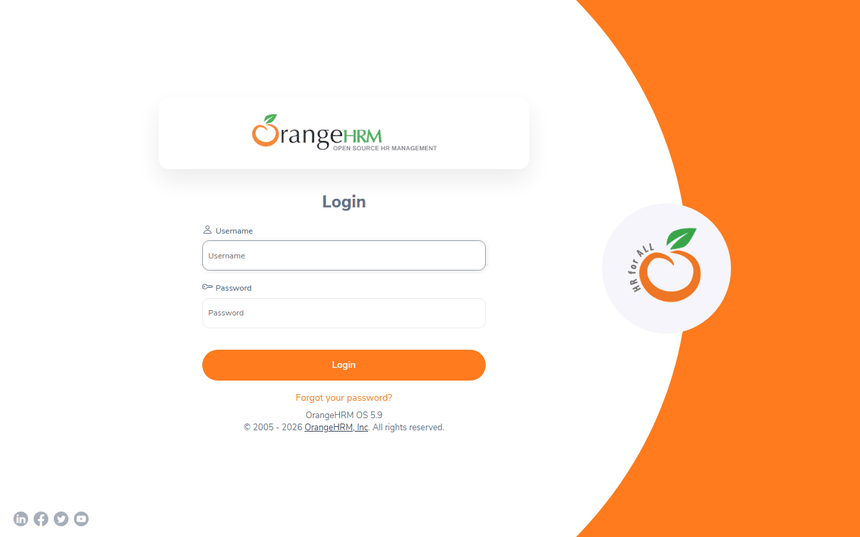

# SynapseQA

[](https://github.com/loudoubleu/synapseqa/actions/workflows/ci.yml)
[](https://github.com/loudoubleu/synapseqa/actions/workflows/nightly.yml)
[](https://github.com/loudoubleu/synapseqa/actions/workflows/demo-smoke.yml)
[](https://loudoubleu.github.io/synapseqa/)

A portfolio-grade test automation framework built with **Playwright + Pytest + Python**, designed the
way a production SDET team would build it: maintainable, layered, CI-ready, and easy to explain in an
interview. It tests both a web UI and its backing REST API from one shared framework.



## Applications under test

| App | Role | Where |
|---|---|---|
| **OrangeHRM 5.9** (open-source HR system) | Main app: web UI **and** its JSON REST API | Local Docker (default); public demo as a secondary environment |
| **Restful Booker** | API-only app: token auth, CRUD, chained requests | Hosted public API |

The two apps show **two authentication styles** side by side: OrangeHRM uses a browser session cookie,
Restful Booker uses a bearer token.

## Objectives

1. **One framework for UI and API testing** — both layers share config, fixtures, reporting and CI.
2. **Hybrid tests** — use the API to set up state and the UI to verify it.
3. **Built for real teams** — parallel runs, multiple environments, traceable failures, containerized CI.
4. **The code is the showcase** — type hints, linting, clean layers, documented decisions (ADRs).
5. **Role-based tests** — prove Admin vs. ESS (regular employee) access at both UI and API level.

## Architecture

```
+------------------------ tests/ -------------------------+
|   ui/        api/        e2e/ (hybrid)    roles/        |
+---------------+---------------------+-------------------+
                | fixtures (conftest) |
+---------------v------+   +----------v--------------+
|  Page/Component Objs  |   |  API Clients (services) |
|  pages/, components/  |   |  api/clients/           |
+---------------+-------+   +----------+--------------+
                |                      |
+---------------v----------------------v-------------------+
| core: config | logging | data builders | models | utils  |
+------------------------------------------------------------+
```

Tests never touch locators or raw HTTP directly. They speak in business terms
(`pim.search_employee(name)`, `employee_api.create(employee)`), through page/component objects and API
clients wired together in `tests/conftest.py`.

### Project layout

```
src/framework/
├── config/settings.py        # pydantic-settings: TEST_-prefixed env vars, local/demo
├── auth/roles.py              # Role enum + expected per-role menu
├── data/builders.py           # Faker-backed EmployeeBuilder, UserBuilder, BookingBuilder
├── ui/
│   ├── pages/                 # BasePage + login/dashboard + pim/ and admin/ subpackages
│   └── components/            # Dropdown, Autocomplete, DatePicker, DataTable, Toast, Modal, SideMenu
└── api/
    ├── base_client.py         # wraps Playwright's APIRequestContext (get/post/put/patch/delete_json)
    ├── models/                # pydantic request/response schemas (contract checks)
    └── clients/                # EmployeeClient, UserClient, BookingClient

tests/
├── conftest.py                 # settings, auth-state (admin + ESS), all API client fixtures
├── ui/        # OrangeHRM UI: login, PIM, visual regression, a11y, network mocking
├── api/        # orangehrm/ and restful_booker/ — pure API tests
├── e2e/        # hybrid: API sets up state, UI verifies it
└── roles/      # Admin vs. ESS access tests
```

### How to add a test

1. **Pick the right layer.** Pure API → `tests/api/<app>/`. UI-only → `tests/ui/`. API sets up state and
   UI verifies it (or vice versa) → `tests/e2e/`. Role/permission-specific → `tests/roles/`.
2. **Reuse or add a page object / API client.** Page objects live in `src/framework/ui/pages/`; they
   expose locators and navigation methods, never assertions. API clients live in
   `src/framework/api/clients/`; they return validated pydantic models, not raw JSON. If the page/
   endpoint you need isn't covered yet, confirm its real locators/payload against the running app
   first (`docker compose -f infra/docker-compose.orangehrm.yml up -d --wait`, then poke around with
   Playwright directly) — never guess field names or locator text.
3. **Generate test data with a builder**, don't hard-code it. `EmployeeBuilder`/`UserBuilder`/
   `BookingBuilder` in `src/framework/data/builders.py` produce Faker-backed data with an
   `auto_<uuid>`-style identifying field.
4. **Clean up what you create.** Either use an existing fixture that already tears down (`employee`,
   `booking`), or add a new one following the same `yield` + delete-in-teardown pattern.
5. **Mark it.** At minimum one of `smoke`/`regression`; also `api`/`ui`/`e2e`/`roles` as appropriate;
   `destructive` if it mutates shared data (auto-skipped when `TEST_ENV=demo`).
6. **Run it, then run the quality gates**, before committing:
   ```powershell
   uv run pytest tests/path/to/test_file.py -v
   uv run ruff check . ; uv run ruff format . ; uv run mypy src tests
   ```

## Quick start (60 seconds)

```powershell
docker compose -f infra/docker-compose.orangehrm.yml up -d --wait
uv sync
uv run playwright install
uv run pytest -m smoke
```

`uv sync` recreates the `.venv` from `uv.lock`; the test run itself waits for OrangeHRM to become ready
before any test executes, so there's no separate manual readiness step.

## Environments

| | `local` (default) | `demo` |
|---|---|---|
| Target | OrangeHRM in Docker on `localhost:8081` | The public OrangeHRM demo site |
| Used for | Development, PR checks, nightly regression | Weekly/manual smoke only |
| Parallel / browser matrix | Allowed | **No** — serial, Chromium, `smoke` only |
| Destructive tests | Allowed | **Skipped automatically** |

Switching is configuration-only (`TEST_ENV=local` or `TEST_ENV=demo`) — no test code changes.

## Running tests

```powershell
uv run pytest -m smoke                       # fast, critical-path checks
uv run pytest -m "api and not destructive"   # API tests, skip anything destructive
uv run pytest --headed --browser firefox     # watch it run in a real browser window
uv run pytest -n 4                           # parallel (local env only)
```

## Quality gates

```powershell
uv run ruff check . ; uv run ruff format . ; uv run mypy src
```

These also run automatically on commit via `pre-commit` (`uv run pre-commit install` once per clone),
and on every pull request in CI (`.github/workflows/ci.yml`).

## CI

| Workflow | Trigger | What runs |
|---|---|---|
| `ci.yml` | Every pull request | Lint, type-check, smoke suite (Chromium) |
| `nightly.yml` | Daily + manual | Full suite across Chromium/Firefox/WebKit, parallelized |
| `demo-smoke.yml` | Weekly + manual | Smoke subset, serial, against the public demo |

Live Allure report (updated after every `nightly.yml` run, history across runs):
**https://loudoubleu.github.io/synapseqa/**

## Architecture Decision Records

Key design decisions and their rationale live in [`docs/adr/`](docs/adr/), e.g. why tests run against a
local Docker instance rather than only the public demo, why API tests use Playwright's own
`APIRequestContext` instead of a separate HTTP library, and why pydantic models back every API contract
check.

## Project status

This project is under active development. See [`TODO.md`](TODO.md) for the live, phase-by-phase
checklist and what's done so far.
